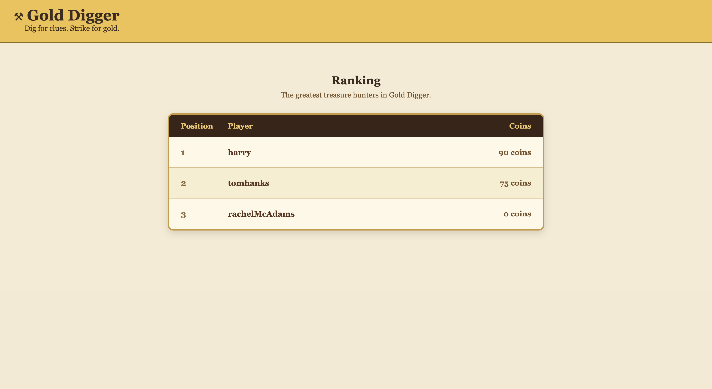
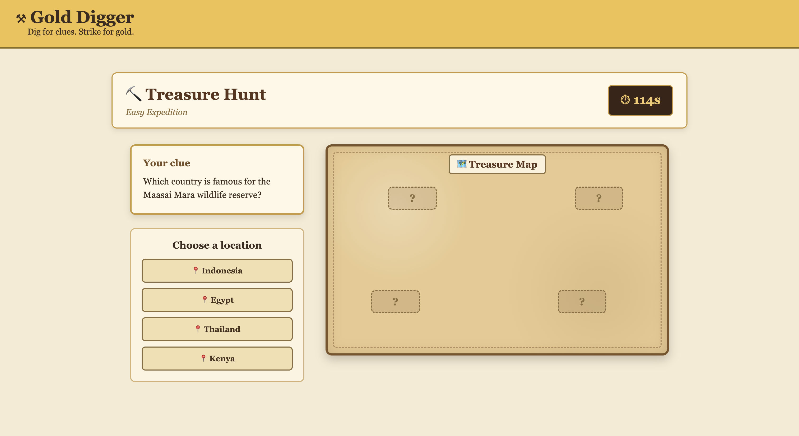

# Exam #3: "Treasure Hunt"
## Student: s364071 GUNEL DENIZ 

## React Client Application Routes

- Route `/`: Home page where logged-in users can choose a difficulty and start a new game, access the instructions page and access the ranking page. Anonymous users can access the login page and the instructions page.
- Route `/login`: Login page where registered users can authenticate.
- Route `/instructions`: Explains the game rules, difficulty levels, timer and scoring.
- Route `/game`: Game page where the player sees the current clue, timer and available locations, and where selected locations are revealed on the map. This route requires authentication.
- Route `/ranking`: Ranking page. Displays registered users ordered by their total coins. This route requires authentication.

## API Server

- POST `/api/something`
  - request parameters and request body content
  - response body content
- GET `/api/something`
  - request parameters
  - response body content
- POST `/api/something`
  - request parameters and request body content
  - response body content
- ...

- POST `/api/sessions`
  - request parameters: none
  - request body content: username, password
  - response body content: req.user containing the authenticated user's userId and username

- GET `/api/sessions/current`
  - request parameters: none
  - response body content:
      - if authenticated -> the user's userId and username
      - otherwise -> { error: "Not authenticated" }

- DELETE `/api/sessions/current`
  - request parameters: none
  - response body content: 
      - successful logout -> none
      - failed logout -> { error: "Logout failed" }

- POST `/api/games`
  - request parameters: none
  - request body content: difficulty
  - response body content: gameId, difficulty, expiresAt, currentStep, the first clue's clueText and available locations' locationId and locationName
  - the server randomly selects the locations and the route for the selected difficulty
  - the route contains half of the selected locations and includes the treasure as the final location
  - the server generates a random treasure value between 10 and 100 coins
  - if the user already has an active game, a new game cannot be started

- POST `/api/games/current/answer`
  - request parameters: none
  - request body content: locationId
  - response body content:
      - for a correct non-final answer -> correct, gameStatus, currentStep, the selected location's locationId, locationName, x, y, the next clue's clueText
      - for an incorrect answer -> correct, gameStatus, treasureCoins and all locations with their locationId, locationName, x, y and routeOrder
      - for an expired game -> gameStatus, treasureCoins and all locations with their locationId, locationName, x, y and routeOrder
      - for a final correct answer -> correct, gameStatus, currentStep, treasureCoins and all locations with their locationId, locationName, x, y and routeOrder

- GET `/api/ranking`
  - request parameters: none
  - request body content: none
  - response body content: a list of users with their username and totalCoins, ordered by total coins from highest to lowest

## Database Tables

- Table `users` - contains userId username saltedPassword salt
- Table `locations` - contains locationId locationName
- Table `clues`- contains clueId clueText locationId
- Table `games`- contains gameId userId difficulty startedAt expiresAt treasureCoins gameStatus currentStep
- Table `gameLocations` - contains gameId locationId positionIndex routeOrder

## Main React Components

- `Layout` (in `Layout.jsx`): provides the common page layout and navigation used across the application.
- `Map` (in `Map.jsx`): displays the game map and reveals the selected locations at their corresponding positions as the player progresses through the game.

(only _main_ components, minor ones may be skipped)

## Screenshot

## Users Credentials

- tomhanks, forrestGump1994
- harry, potter
- rachelMcAdams, BURNBOOK

## Use of AI Tools

ChatGPT was used during the development of this project to clarify programming concepts, help with debugging, review and improve code, and assist with understanding the requirements of the assignment. The generated code and suggestions were reviewed, tested and adapted to fit the project requirements and the implemented application.
